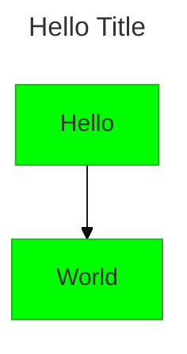
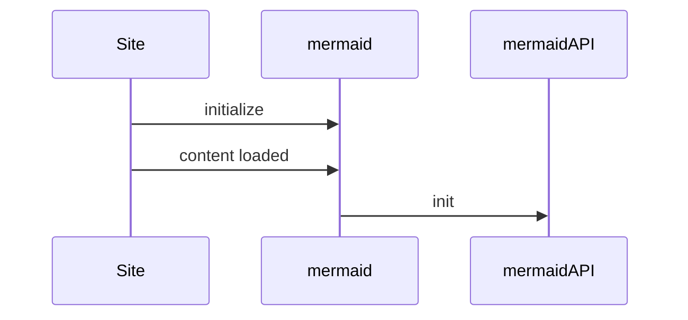

> **Warning**
>
> ## THIS IS AN AUTOGENERATED FILE. DO NOT EDIT.
>
> ## Please edit the corresponding file in [/packages/mermaid/src/docs/config/configuration.md](../../packages/mermaid/src/docs/config/configuration.md).

# Configuration

When mermaid starts, configuration is extracted to determine a configuration to be used for a diagram. There are 3 sources for configuration:

- The default configuration
- Overrides at the site level are set by the initialize call, and will be applied to all diagrams in the site/app. The term for this is the **siteConfig**.
- Frontmatter (v10.5.0+) - diagram authors can update selected configuration parameters in the frontmatter of the diagram. These are applied to the render config.
- Directives (Deprecated by Frontmatter) - diagram authors can update selected configuration parameters directly in the diagram code via directives. These are applied to the render config.

**The render config** is configuration that is used when rendering by applying these configurations.

## Frontmatter config

The entire mermaid configuration (except the secure configs) can be overridden by the diagram author in the frontmatter of the diagram. The frontmatter is a YAML block at the top of the diagram.




### Write nested options as nested YAML

The frontmatter is parsed as YAML without expanding dots.
`elk.mergeEdges: true` is therefore one key named `elk.mergeEdges`, not the option `mergeEdges` of the `elk` section.
Mermaid ignores that key and renders as if the option were not set.
Write the section and the option on separate levels:

```yaml
config:
  elk:
    mergeEdges: true
```

When a key directly under `config:` contains dots and starts with the name of a config section, such as `elk`, `flowchart` or `themeVariables`, mermaid logs a warning that names the key and shows the nested form.
A section is any option of the default configuration that holds nested options, so `dompurifyConfig`, which has no default, is not one.
The key stays ignored.
The warning shows at most four parts of the key, and cuts the key and each part at 80 characters.

The default `logLevel` is `fatal`, so the warning is invisible until you lower it to `warn` (or `3`) or below when you initialize mermaid:

```js
mermaid.initialize({ logLevel: 'warn' });
```

A `logLevel` in the frontmatter does not turn the warning on, because mermaid reads the log level only when it initializes.

These dotted keys are ignored without a warning:

- Keys that do not start with a config section, such as `foo.bar`, a plain option such as `theme.mode`, or a list option such as `secure`.
- Keys with an empty part, such as `elk.` or `elk..mergeEdges`.
- Keys inside a section, such as `"elk.mergeEdges"` under `flowchart:`.
- Keys in a `%%{init}%%` directive or in `mermaid.initialize()`, which this check does not read.

## Theme configuration

## Starting mermaid




## Initialize

The initialize call is applied **only once**. It is called by the site integrator in order to override the default configuration at a site level.

## configApi.reset

This method resets the configuration for a diagram to the overall site configuration, which is the configuration provided by the site integrator. Before each rendering of a diagram, reset is called at the very beginning.
