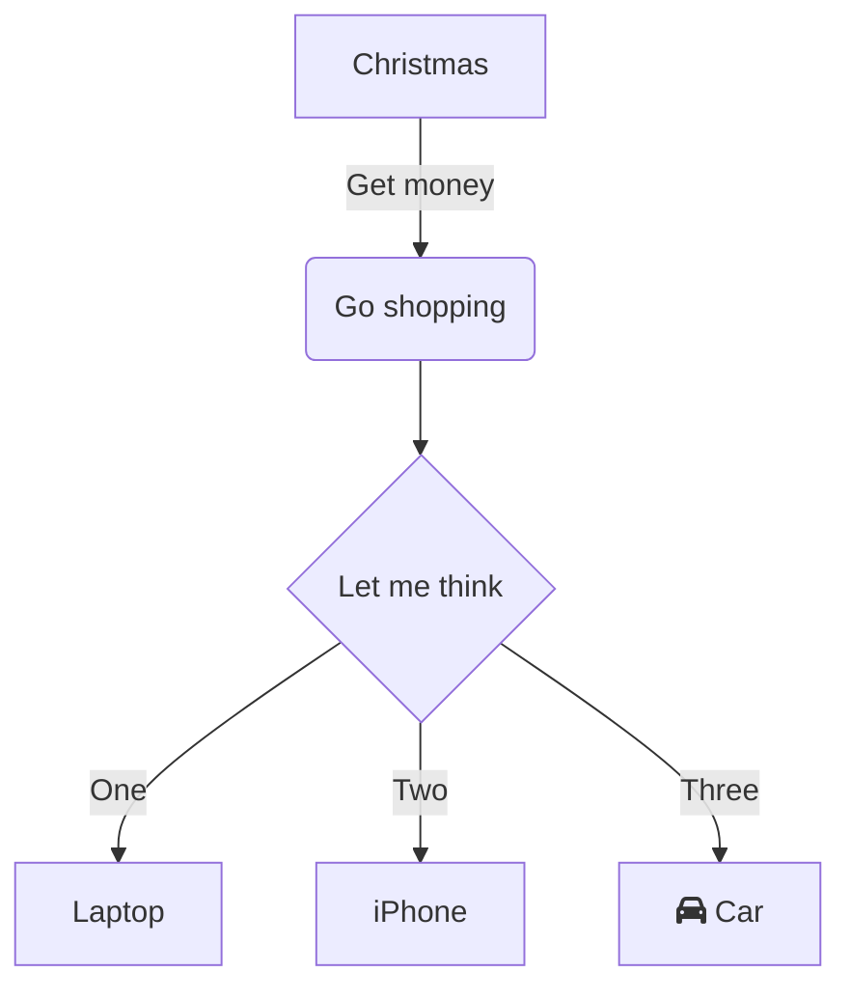
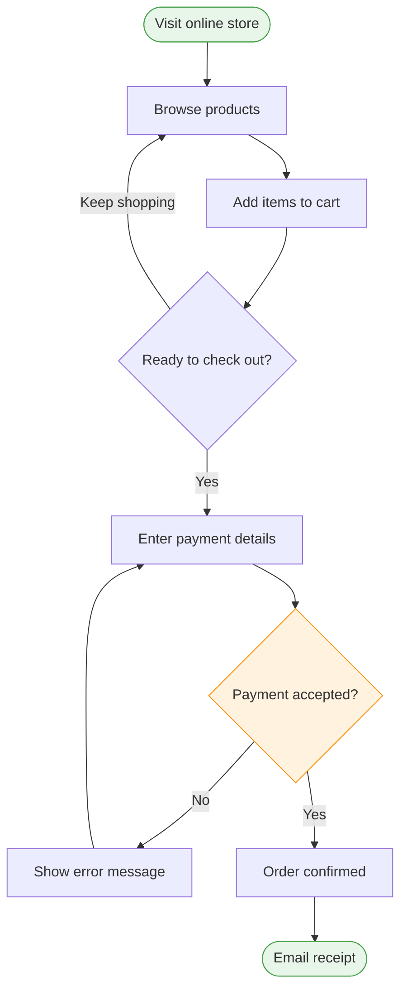
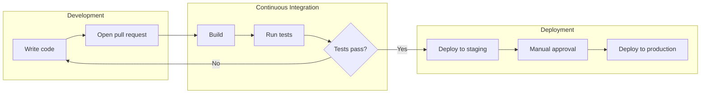
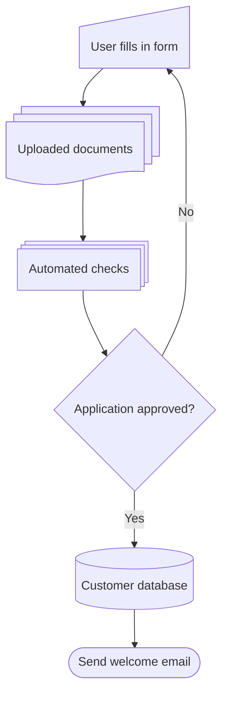
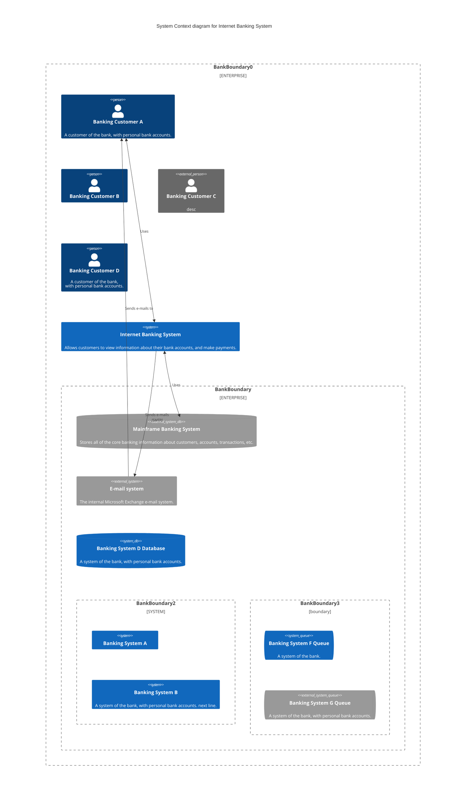
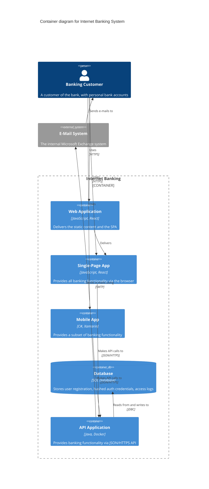
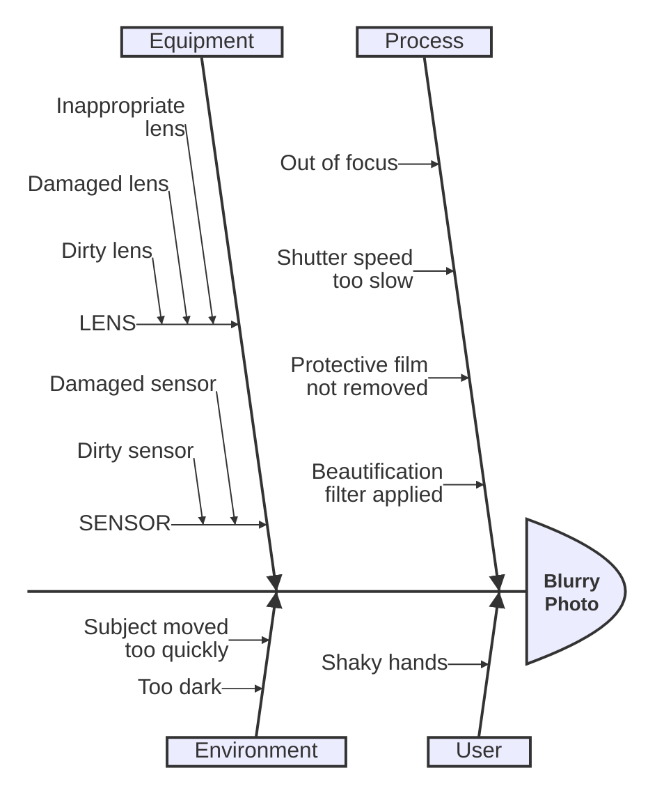
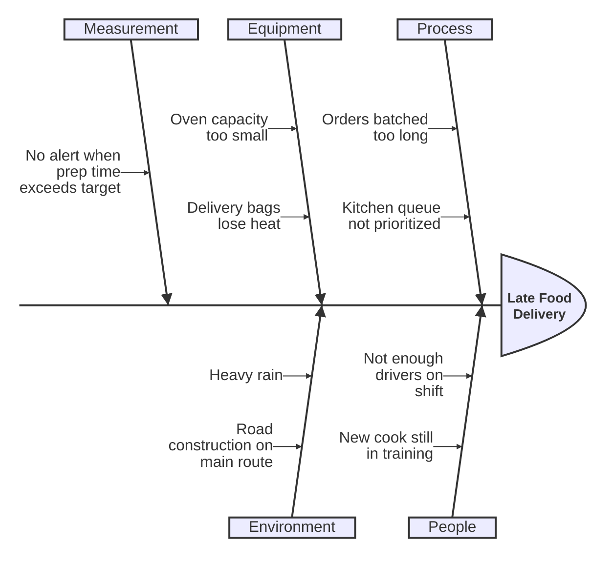
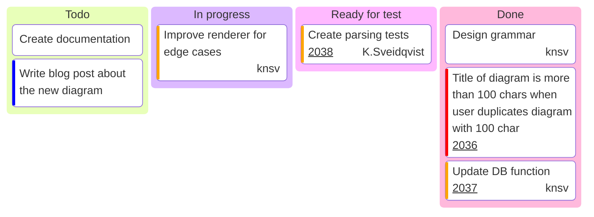
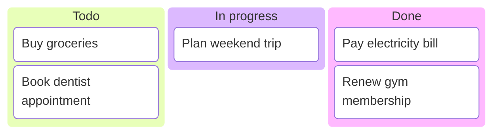

> **Warning**
>
> ## THIS IS AN AUTOGENERATED FILE. DO NOT EDIT.
>
> ## Please edit the corresponding file in [/packages/mermaid/src/docs/syntax/all-examples.md](../../packages/mermaid/src/docs/syntax/all-examples.md).

# All Diagram Examples

## Flowchart

Visualize flowcharts and directed graphs

### Basic Flowchart



<details>
<summary>Code</summary>


</details>

### Online Checkout Flow



<details>
<summary>Code</summary>


</details>

### CI/CD Pipeline with Subgraphs



<details>
<summary>Code</summary>


</details>

### Expanded Node Shapes



<details>
<summary>Code</summary>


</details>

## C4 Diagram

Visualize software architecture using the C4 model (Context, Container, Component, Code)

### Internet Banking System Context



<details>
<summary>Code</summary>


</details>

### Internet Banking Container Diagram



<details>
<summary>Code</summary>


</details>

## Ishikawa Diagram

Visualize problem and causes in fishbone

### Ishikawa Diagram



<details>
<summary>Code</summary>


</details>

### Late Food Delivery Root Causes



<details>
<summary>Code</summary>


</details>

## Kanban Diagram

Visualize work items in a Kanban board

### Mermaid Sprint Board



<details>
<summary>Code</summary>


</details>

### Personal Task Board



<details>
<summary>Code</summary>


</details>

## Class Diagram

Visualize class structures and relationships in object-oriented programming

### Basic Class Inheritance

```mermaid
classDiagram
    Animal <|-- Duck
    Animal <|-- Fish
    Animal <|-- Zebra
    Animal : +int age
    Animal : +String gender
    Animal: +isMammal()
    Animal: +mate()
    class Duck{
      +String beakColor
      +swim()
      +quack()
    }
    class Fish{
      -int sizeInFeet
      -canEat()
    }
    class Zebra{
      +bool is_wild
      +run()
    }
```

<details>
<summary>Code</summary>

```mermaid-example
classDiagram
    Animal <|-- Duck
    Animal <|-- Fish
    Animal <|-- Zebra
    Animal : +int age
    Animal : +String gender
    Animal: +isMammal()
    Animal: +mate()
    class Duck{
      +String beakColor
      +swim()
      +quack()
    }
    class Fish{
      -int sizeInFeet
      -canEat()
    }
    class Zebra{
      +bool is_wild
      +run()
    }
```

</details>

### E-commerce Domain Model

```mermaid
classDiagram
    direction LR
    class Customer {
        +String name
        +String email
        +register()
        +placeOrder() Order
    }
    class Order {
        +Date createdAt
        +List~OrderItem~ items
        +addItem(Product product, int quantity)
        +total() float
    }
    class OrderItem {
        +int quantity
        +float unitPrice
    }
    class Product {
        +String name
        +float price
    }
    class PaymentMethod {
        <<interface>>
        +authorize(float amount) bool
    }
    class CreditCard {
        +String maskedNumber
        +authorize(float amount) bool
    }
    class GiftCard {
        +float balance
        +authorize(float amount) bool
    }

    Customer "1" --> "0..*" Order : places
    Order "1" *-- "1..*" OrderItem : contains
    OrderItem "0..*" --> "1" Product : refers to
    PaymentMethod <|.. CreditCard
    PaymentMethod <|.. GiftCard
    Order --> PaymentMethod : paid via

    note for PaymentMethod "New payment providers only
need to implement authorize()"
```

<details>
<summary>Code</summary>

```mermaid-example
classDiagram
    direction LR
    class Customer {
        +String name
        +String email
        +register()
        +placeOrder() Order
    }
    class Order {
        +Date createdAt
        +List~OrderItem~ items
        +addItem(Product product, int quantity)
        +total() float
    }
    class OrderItem {
        +int quantity
        +float unitPrice
    }
    class Product {
        +String name
        +float price
    }
    class PaymentMethod {
        <<interface>>
        +authorize(float amount) bool
    }
    class CreditCard {
        +String maskedNumber
        +authorize(float amount) bool
    }
    class GiftCard {
        +float balance
        +authorize(float amount) bool
    }

    Customer "1" --> "0..*" Order : places
    Order "1" *-- "1..*" OrderItem : contains
    OrderItem "0..*" --> "1" Product : refers to
    PaymentMethod <|.. CreditCard
    PaymentMethod <|.. GiftCard
    Order --> PaymentMethod : paid via

    note for PaymentMethod "New payment providers only
need to implement authorize()"
```

</details>

## Sequence Diagram

Visualize interactions between objects over time

### Basic Sequence

```mermaid
sequenceDiagram
    Alice->>+John: Hello John, how are you?
    Alice->>+John: John, can you hear me?
    John-->>-Alice: Hi Alice, I can hear you!
    John-->>-Alice: I feel great!
```

<details>
<summary>Code</summary>

```mermaid-example
sequenceDiagram
    Alice->>+John: Hello John, how are you?
    Alice->>+John: John, can you hear me?
    John-->>-Alice: Hi Alice, I can hear you!
    John-->>-Alice: I feel great!
```

</details>

### Online Payment Flow

```mermaid
sequenceDiagram
    autonumber
    actor Customer
    participant Shop as Web Shop
    participant Pay as Payment Service
    participant Bank

    Customer->>Shop: Place order
    activate Shop
    Shop->>Pay: Create payment request
    activate Pay
    Pay->>Bank: Authorize card
    Bank-->>Pay: Authorization result
    alt Payment approved
        Pay-->>Shop: Payment confirmed
        Shop-->>Customer: Show receipt
    else Payment declined
        Pay-->>Shop: Payment failed
        Shop-->>Customer: Ask for another card
    end
    deactivate Pay
    deactivate Shop
```

<details>
<summary>Code</summary>

```mermaid-example
sequenceDiagram
    autonumber
    actor Customer
    participant Shop as Web Shop
    participant Pay as Payment Service
    participant Bank

    Customer->>Shop: Place order
    activate Shop
    Shop->>Pay: Create payment request
    activate Pay
    Pay->>Bank: Authorize card
    Bank-->>Pay: Authorization result
    alt Payment approved
        Pay-->>Shop: Payment confirmed
        Shop-->>Customer: Show receipt
    else Payment declined
        Pay-->>Shop: Payment failed
        Shop-->>Customer: Ask for another card
    end
    deactivate Pay
    deactivate Shop
```

</details>

### Food Delivery with Parallel Actions

```mermaid
sequenceDiagram
    participant App as Mobile App
    participant API as Order Service
    participant Kitchen
    actor Courier

    App->>API: Submit order
    Note right of API: Validate items,<br/>charge payment
    par Notify kitchen
        API->>Kitchen: New order ticket
    and Confirm to customer
        API-->>App: Order accepted, ETA 30 min
    end
    Kitchen-->>API: Order ready
    API->>Courier: Request pickup
    loop Until delivered
        Courier->>App: Share live location
    end
    Courier-->>App: Order delivered
```

<details>
<summary>Code</summary>

```mermaid-example
sequenceDiagram
    participant App as Mobile App
    participant API as Order Service
    participant Kitchen
    actor Courier

    App->>API: Submit order
    Note right of API: Validate items,<br/>charge payment
    par Notify kitchen
        API->>Kitchen: New order ticket
    and Confirm to customer
        API-->>App: Order accepted, ETA 30 min
    end
    Kitchen-->>API: Order ready
    API->>Courier: Request pickup
    loop Until delivered
        Courier->>App: Share live location
    end
    Courier-->>App: Order delivered
```

</details>

## Pie Chart

Visualize data as proportional segments of a circle

### Basic Pie Chart

```mermaid
pie title Pets adopted by volunteers
    "Dogs" : 386
    "Cats" : 85
    "Rats" : 15
```

<details>
<summary>Code</summary>

```mermaid-example
pie title Pets adopted by volunteers
    "Dogs" : 386
    "Cats" : 85
    "Rats" : 15
```

</details>

### Workday Breakdown with Values

```mermaid
pie showData title Where the workday goes (minutes)
    "Focused work" : 210
    "Meetings" : 120
    "Email and chat" : 90
    "Breaks" : 45
    "Context switching" : 15
```

<details>
<summary>Code</summary>

```mermaid-example
pie showData title Where the workday goes (minutes)
    "Focused work" : 210
    "Meetings" : 120
    "Email and chat" : 90
    "Breaks" : 45
    "Context switching" : 15
```

</details>

## User Journey Diagram

Visualize user interactions and experiences with a system

### My Working Day

```mermaid
journey
    title My working day
    section Go to work
      Make tea: 5: Me
      Go upstairs: 3: Me
      Do work: 1: Me, Cat
    section Go home
      Go downstairs: 5: Me
      Sit down: 5: Me
```

<details>
<summary>Code</summary>

```mermaid-example
journey
    title My working day
    section Go to work
      Make tea: 5: Me
      Go upstairs: 3: Me
      Do work: 1: Me, Cat
    section Go home
      Go downstairs: 5: Me
      Sit down: 5: Me
```

</details>

### Online Grocery Shopping

```mermaid
journey
    title Ordering groceries online
    section Browse and select
      Search for items: 6: Customer
      Compare prices: 4: Customer
      Add to basket: 7: Customer
    section Checkout
      Choose delivery slot: 5: Customer
      Pay for order: 3: Customer
    section Fulfilment
      Pick items in store: 4: Store staff
      Deliver groceries: 5: Driver
      Unpack at home: 7: Customer
```

<details>
<summary>Code</summary>

```mermaid-example
journey
    title Ordering groceries online
    section Browse and select
      Search for items: 6: Customer
      Compare prices: 4: Customer
      Add to basket: 7: Customer
    section Checkout
      Choose delivery slot: 5: Customer
      Pay for order: 3: Customer
    section Fulfilment
      Pick items in store: 4: Store staff
      Deliver groceries: 5: Driver
      Unpack at home: 7: Customer
```

</details>

## Mindmap

Visualize ideas and concepts in a tree-like structure

### Basic Mindmap

```mermaid
mindmap
  root((mindmap))
    Origins
      Long history
      ::icon(fa fa-book)
      Popularisation
        British popular psychology author Tony Buzan
    Research
      On effectiveness<br/>and features
      On Automatic creation
        Uses
            Creative techniques
            Strategic planning
            Argument mapping
    Tools
      Pen and paper
      Mermaid
```

<details>
<summary>Code</summary>

```mermaid-example
mindmap
  root((mindmap))
    Origins
      Long history
      ::icon(fa fa-book)
      Popularisation
        British popular psychology author Tony Buzan
    Research
      On effectiveness<br/>and features
      On Automatic creation
        Uses
            Creative techniques
            Strategic planning
            Argument mapping
    Tools
      Pen and paper
      Mermaid
```

</details>

### Trip Planning with Shapes and Icons

```mermaid
mindmap
  root((Summer Trip))
    Destination
      Beach town
      Mountain village
    Budget
      ::icon(fa fa-wallet)
      Flights
      Hotel
      Food and activities
    Packing
      Documents
        Passport
        Travel insurance
      reminder{{Sunscreen!}}
    Activities
      ::icon(fa fa-person-hiking)
      Hiking
      Snorkeling
      Local food tour
```

<details>
<summary>Code</summary>

```mermaid-example
mindmap
  root((Summer Trip))
    Destination
      Beach town
      Mountain village
    Budget
      ::icon(fa fa-wallet)
      Flights
      Hotel
      Food and activities
    Packing
      Documents
        Passport
        Travel insurance
      reminder{{Sunscreen!}}
    Activities
      ::icon(fa fa-person-hiking)
      Hiking
      Snorkeling
      Local food tour
```

</details>

## Requirement Diagram

Visualize system requirements and their relationships

### E-Bike Braking System

```mermaid
requirementDiagram

    requirement rider_safety {
        id: 1
        text: Riders must be able to stop safely in all conditions.
        risk: high
        verifymethod: test
    }

    functionalRequirement brake_response {
        id: 1.1
        text: Brakes engage within 100 ms of lever pull.
        risk: medium
        verifymethod: test
    }

    performanceRequirement stopping_distance {
        id: 1.2
        text: Stop from 25 km/h within 4 m on dry pavement.
        risk: medium
        verifymethod: demonstration
    }

    designConstraint water_resistance {
        id: 1.3
        text: Brake electronics must be IP67 rated.
        risk: low
        verifymethod: inspection
    }

    element brake_controller {
        type: hardware
        docRef: "specs/brake-controller"
    }

    element road_test_suite {
        type: "test suite"
        docRef: "qa/road-tests"
    }

    rider_safety - contains -> brake_response
    rider_safety - contains -> stopping_distance
    brake_response - derives -> water_resistance
    brake_controller - satisfies -> brake_response
    road_test_suite - verifies -> stopping_distance
```

<details>
<summary>Code</summary>

```mermaid-example
requirementDiagram

    requirement rider_safety {
        id: 1
        text: Riders must be able to stop safely in all conditions.
        risk: high
        verifymethod: test
    }

    functionalRequirement brake_response {
        id: 1.1
        text: Brakes engage within 100 ms of lever pull.
        risk: medium
        verifymethod: test
    }

    performanceRequirement stopping_distance {
        id: 1.2
        text: Stop from 25 km/h within 4 m on dry pavement.
        risk: medium
        verifymethod: demonstration
    }

    designConstraint water_resistance {
        id: 1.3
        text: Brake electronics must be IP67 rated.
        risk: low
        verifymethod: inspection
    }

    element brake_controller {
        type: hardware
        docRef: "specs/brake-controller"
    }

    element road_test_suite {
        type: "test suite"
        docRef: "qa/road-tests"
    }

    rider_safety - contains -> brake_response
    rider_safety - contains -> stopping_distance
    brake_response - derives -> water_resistance
    brake_controller - satisfies -> brake_response
    road_test_suite - verifies -> stopping_distance
```

</details>

## Radar Diagram

Visualize data in a radial format

### Student Grades

```mermaid
---
title: "Grades"
---
radar-beta
  axis m["Math"], s["Science"], e["English"]
  axis h["History"], g["Geography"], a["Art"]
  curve a["Alice"]{85, 90, 80, 70, 75, 90}
  curve b["Bob"]{70, 75, 85, 80, 90, 85}

  max 100
  min 0

```

<details>
<summary>Code</summary>

```mermaid-example
---
title: "Grades"
---
radar-beta
  axis m["Math"], s["Science"], e["English"]
  axis h["History"], g["Geography"], a["Art"]
  curve a["Alice"]{85, 90, 80, 70, 75, 90}
  curve b["Bob"]{70, 75, 85, 80, 90, 85}

  max 100
  min 0

```

</details>

### Framework Comparison with Polygon Grid

```mermaid
radar-beta
  title Frontend Framework Comparison
  axis perf["Performance"], dx["Dev Experience"], eco["Ecosystem"]
  axis learn["Easy to Learn"], docs["Documentation"]

  curve react["React"]{4, 4, 5, 3, 4}
  curve vue["Vue"]{4, 5, 4, 4, 5}
  curve svelte["Svelte"]{5, 5, 3, 4, 4}

  graticule polygon
  max 5
  min 0
```

<details>
<summary>Code</summary>

```mermaid-example
radar-beta
  title Frontend Framework Comparison
  axis perf["Performance"], dx["Dev Experience"], eco["Ecosystem"]
  axis learn["Easy to Learn"], docs["Documentation"]

  curve react["React"]{4, 4, 5, 3, 4}
  curve vue["Vue"]{4, 5, 4, 4, 5}
  curve svelte["Svelte"]{5, 5, 3, 4, 4}

  graticule polygon
  max 5
  min 0
```

</details>

## State Diagram

Visualize the states and transitions of a system

### Basic State Diagram

```mermaid
stateDiagram-v2
    [*] --> Still
    Still --> [*]
    Still --> Moving
    Moving --> Still
    Moving --> Crash
    Crash --> [*]
```

<details>
<summary>Code</summary>

```mermaid-example
stateDiagram-v2
    [*] --> Still
    Still --> [*]
    Still --> Moving
    Moving --> Still
    Moving --> Crash
    Crash --> [*]
```

</details>

### Order Lifecycle with Composite States

```mermaid
stateDiagram-v2
    direction LR
    [*] --> Placed
    Placed --> Paid : payment received
    Placed --> Cancelled : customer cancels
    Paid --> Fulfilment

    state Fulfilment {
        [*] --> Packing
        Packing --> Shipped : handed to courier
        Shipped --> [*]
    }

    Fulfilment --> Delivered : courier confirms
    Delivered --> [*]
    Cancelled --> [*]

    note right of Paid
        Payment can be card,
        wallet, or bank transfer
    end note
```

<details>
<summary>Code</summary>

```mermaid-example
stateDiagram-v2
    direction LR
    [*] --> Placed
    Placed --> Paid : payment received
    Placed --> Cancelled : customer cancels
    Paid --> Fulfilment

    state Fulfilment {
        [*] --> Packing
        Packing --> Shipped : handed to courier
        Shipped --> [*]
    }

    Fulfilment --> Delivered : courier confirms
    Delivered --> [*]
    Cancelled --> [*]

    note right of Paid
        Payment can be card,
        wallet, or bank transfer
    end note
```

</details>

### Choice and Concurrency

```mermaid
stateDiagram-v2
    state battery_check <<choice>>
    [*] --> PowerOn
    PowerOn --> battery_check
    battery_check --> LowPowerMode : battery < 20%
    battery_check --> Active : battery >= 20%

    state Active {
        [*] --> Playing
        Playing --> Paused : pause
        Paused --> Playing : play
        --
        [*] --> ScreenOn
        ScreenOn --> ScreenDimmed : idle 30s
        ScreenDimmed --> ScreenOn : touch
    }

    LowPowerMode --> [*] : power off
    Active --> [*] : power off
```

<details>
<summary>Code</summary>

```mermaid-example
stateDiagram-v2
    state battery_check <<choice>>
    [*] --> PowerOn
    PowerOn --> battery_check
    battery_check --> LowPowerMode : battery < 20%
    battery_check --> Active : battery >= 20%

    state Active {
        [*] --> Playing
        Playing --> Paused : pause
        Paused --> Playing : play
        --
        [*] --> ScreenOn
        ScreenOn --> ScreenDimmed : idle 30s
        ScreenDimmed --> ScreenOn : touch
    }

    LowPowerMode --> [*] : power off
    Active --> [*] : power off
```

</details>

## Entity Relationship Diagram

Visualize database schemas and relationships between entities

### Basic ER Schema

```mermaid
erDiagram
    CUSTOMER ||--o{ ORDER : places
    ORDER ||--|{ ORDER_ITEM : contains
    PRODUCT ||--o{ ORDER_ITEM : includes
    CUSTOMER {
        string id
        string name
        string email
    }
    ORDER {
        string id
        date orderDate
        string status
    }
    PRODUCT {
        string id
        string name
        float price
    }
    ORDER_ITEM {
        int quantity
        float price
    }
```

<details>
<summary>Code</summary>

```mermaid-example
erDiagram
    CUSTOMER ||--o{ ORDER : places
    ORDER ||--|{ ORDER_ITEM : contains
    PRODUCT ||--o{ ORDER_ITEM : includes
    CUSTOMER {
        string id
        string name
        string email
    }
    ORDER {
        string id
        date orderDate
        string status
    }
    PRODUCT {
        string id
        string name
        float price
    }
    ORDER_ITEM {
        int quantity
        float price
    }
```

</details>

### Streaming Service with Keys and Comments

```mermaid
erDiagram
    USER ||--o{ SUBSCRIPTION : has
    PLAN ||--o{ SUBSCRIPTION : "subscribed via"
    USER ||--o{ WATCH_HISTORY : logs
    EPISODE ||--o{ WATCH_HISTORY : "appears in"
    SHOW ||--|{ EPISODE : contains
    USER {
        string id PK
        string email UK "Used for login"
        string country
    }
    SUBSCRIPTION {
        string id PK
        string userId FK
        string planId FK
        date startedAt
        bool autoRenew
    }
    PLAN {
        string id PK
        string name "Basic, Standard or Premium"
        float monthlyPrice
    }
    SHOW {
        string id PK
        string title
        string genre
    }
    EPISODE {
        string id PK
        string showId FK
        int seasonNumber
        int episodeNumber
    }
    WATCH_HISTORY {
        string userId FK
        string episodeId FK
        date watchedAt
        int secondsWatched
    }
```

<details>
<summary>Code</summary>

```mermaid-example
erDiagram
    USER ||--o{ SUBSCRIPTION : has
    PLAN ||--o{ SUBSCRIPTION : "subscribed via"
    USER ||--o{ WATCH_HISTORY : logs
    EPISODE ||--o{ WATCH_HISTORY : "appears in"
    SHOW ||--|{ EPISODE : contains
    USER {
        string id PK
        string email UK "Used for login"
        string country
    }
    SUBSCRIPTION {
        string id PK
        string userId FK
        string planId FK
        date startedAt
        bool autoRenew
    }
    PLAN {
        string id PK
        string name "Basic, Standard or Premium"
        float monthlyPrice
    }
    SHOW {
        string id PK
        string title
        string genre
    }
    EPISODE {
        string id PK
        string showId FK
        int seasonNumber
        int episodeNumber
    }
    WATCH_HISTORY {
        string userId FK
        string episodeId FK
        date watchedAt
        int secondsWatched
    }
```

</details>

## Git Graph

Visualize Git repository history and branch relationships

### Basic Git Flow

```mermaid
gitGraph
    commit id: "a3f82c1"
    branch develop
    checkout develop
    commit id: "b7e41d9"
    commit id: "c9d52e4"
    checkout main
    merge develop id: "d4e8f3a"
    commit id: "e1b6c90"
    branch feature
    checkout feature
    commit id: "f2a8d17"
    commit id: "a8c3f54"
    checkout main
    merge feature id: "b9d7e21"
```

<details>
<summary>Code</summary>

```mermaid-example
gitGraph
    commit id: "a3f82c1"
    branch develop
    checkout develop
    commit id: "b7e41d9"
    commit id: "c9d52e4"
    checkout main
    merge develop id: "d4e8f3a"
    commit id: "e1b6c90"
    branch feature
    checkout feature
    commit id: "f2a8d17"
    commit id: "a8c3f54"
    checkout main
    merge feature id: "b9d7e21"
```

</details>

### Release and Hotfix Workflow

```mermaid
gitGraph
    commit id: "initial setup"
    branch develop
    commit id: "feat: login page"
    commit id: "feat: search"
    checkout main
    merge develop tag: "v1.0.0"
    checkout develop
    commit id: "feat: user profile"
    checkout main
    branch hotfix
    commit id: "fix: crash on load"
    checkout main
    merge hotfix tag: "v1.0.1"
    checkout develop
    cherry-pick id: "fix: crash on load"
    commit id: "feat: dark mode"
    checkout main
    merge develop tag: "v1.1.0"
```

<details>
<summary>Code</summary>

```mermaid-example
gitGraph
    commit id: "initial setup"
    branch develop
    commit id: "feat: login page"
    commit id: "feat: search"
    checkout main
    merge develop tag: "v1.0.0"
    checkout develop
    commit id: "feat: user profile"
    checkout main
    branch hotfix
    commit id: "fix: crash on load"
    checkout main
    merge hotfix tag: "v1.0.1"
    checkout develop
    cherry-pick id: "fix: crash on load"
    commit id: "feat: dark mode"
    checkout main
    merge develop tag: "v1.1.0"
```

</details>

### Highlighted Commits

```mermaid
gitGraph TB:
    commit id: "v2 groundwork"
    commit id: "schema migration" type: HIGHLIGHT
    commit id: "revert experiment" type: REVERSE
    commit id: "stabilize" tag: "v2.0.0-rc1"
```

<details>
<summary>Code</summary>

```mermaid-example
gitGraph TB:
    commit id: "v2 groundwork"
    commit id: "schema migration" type: HIGHLIGHT
    commit id: "revert experiment" type: REVERSE
    commit id: "stabilize" tag: "v2.0.0-rc1"
```

</details>

## Architecture Diagram

Visualize system architecture and components

### Basic System Architecture

```mermaid
architecture-beta
    group api(cloud)[API]

    service db(database)[Database] in api
    service disk1(disk)[Storage] in api
    service disk2(disk)[Storage] in api
    service server(server)[Server] in api

    db:L -- R:server
    disk1:T -- B:server
    disk2:T -- B:db
```

<details>
<summary>Code</summary>

```mermaid-example
architecture-beta
    group api(cloud)[API]

    service db(database)[Database] in api
    service disk1(disk)[Storage] in api
    service disk2(disk)[Storage] in api
    service server(server)[Server] in api

    db:L -- R:server
    disk1:T -- B:server
    disk2:T -- B:db
```

</details>

### Web App with Frontend and Backend Groups

```mermaid
architecture-beta
    group frontend(cloud)[Frontend]
    group backend(cloud)[Backend]

    service web(internet)[Website] in frontend
    service mobile(internet)[Mobile App] in frontend
    service api(server)[API Server] in backend
    service auth(server)[Auth Service] in backend
    service db(database)[Database] in backend
    service files(disk)[File Storage] in backend

    web:R --> L:api
    mobile:R --> L:api
    api:R --> L:auth
    api:B --> T:db
    db:R -- L:files
```

<details>
<summary>Code</summary>

```mermaid-example
architecture-beta
    group frontend(cloud)[Frontend]
    group backend(cloud)[Backend]

    service web(internet)[Website] in frontend
    service mobile(internet)[Mobile App] in frontend
    service api(server)[API Server] in backend
    service auth(server)[Auth Service] in backend
    service db(database)[Database] in backend
    service files(disk)[File Storage] in backend

    web:R --> L:api
    mobile:R --> L:api
    api:R --> L:auth
    api:B --> T:db
    db:R -- L:files
```

</details>

### Load Balancing with Junctions

```mermaid
architecture-beta
    service user(internet)[User]
    service lb(server)[Load Balancer]
    service app1(server)[App Server 1]
    service app2(server)[App Server 2]
    junction fanout

    user:R -- L:lb
    lb:R -- L:fanout
    app1:B -- T:fanout
    app2:T -- B:fanout
```

<details>
<summary>Code</summary>

```mermaid-example
architecture-beta
    service user(internet)[User]
    service lb(server)[Load Balancer]
    service app1(server)[App Server 1]
    service app2(server)[App Server 2]
    junction fanout

    user:R -- L:lb
    lb:R -- L:fanout
    app1:B -- T:fanout
    app2:T -- B:fanout
```

</details>

## XY Chart

Create scatter plots and line charts with customizable axes

### Sales Revenue

```mermaid
xychart-beta
    title "Sales Revenue"
    x-axis [jan, feb, mar, apr, may, jun, jul, aug, sep, oct, nov, dec]
    y-axis "Revenue (in $)" 4000 --> 11000
    bar [5000, 6000, 7500, 8200, 9500, 10500, 11000, 10200, 9200, 8500, 7000, 6000]
    line [5000, 6000, 7500, 8200, 9500, 10500, 11000, 10200, 9200, 8500, 7000, 6000]
```

<details>
<summary>Code</summary>

```mermaid-example
xychart-beta
    title "Sales Revenue"
    x-axis [jan, feb, mar, apr, may, jun, jul, aug, sep, oct, nov, dec]
    y-axis "Revenue (in $)" 4000 --> 11000
    bar [5000, 6000, 7500, 8200, 9500, 10500, 11000, 10200, 9200, 8500, 7000, 6000]
    line [5000, 6000, 7500, 8200, 9500, 10500, 11000, 10200, 9200, 8500, 7000, 6000]
```

</details>

### Coffee Sales with Data Labels

```mermaid
---
config:
  xyChart:
    showDataLabel: true
---
xychart-beta
    title "Cups sold per day"
    x-axis [Espresso, Latte, "Cold Brew", Mocha, Tea]
    y-axis "Cups" 0 --> 120
    bar [95, 110, 68, 45, 30]
```

<details>
<summary>Code</summary>

```mermaid-example
---
config:
  xyChart:
    showDataLabel: true
---
xychart-beta
    title "Cups sold per day"
    x-axis [Espresso, Latte, "Cold Brew", Mocha, Tea]
    y-axis "Cups" 0 --> 120
    bar [95, 110, 68, 45, 30]
```

</details>

### Sign-ups vs Churn

```mermaid
---
config:
  themeVariables:
    xyChart:
      plotColorPalette: '#2563eb, #dc2626'
---
xychart-beta
    title "Sign-ups vs churned users"
    x-axis [Q1, Q2, Q3, Q4]
    y-axis "Users" 0 --> 500
    line [120, 260, 380, 470]
    line [40, 60, 90, 110]
```

<details>
<summary>Code</summary>

```mermaid-example
---
config:
  themeVariables:
    xyChart:
      plotColorPalette: '#2563eb, #dc2626'
---
xychart-beta
    title "Sign-ups vs churned users"
    x-axis [Q1, Q2, Q3, Q4]
    y-axis "Users" 0 --> 500
    line [120, 260, 380, 470]
    line [40, 60, 90, 110]
```

</details>

## Sankey Diagram

Visualize flow quantities between different stages or processes

### Monthly Budget Flow

```mermaid
sankey-beta

Salary,Budget,3000
Freelance work,Budget,1200
Budget,Rent,1300
Budget,Groceries,600
Budget,Transport,250
Budget,Fun,350
Budget,Savings,1700
```

<details>
<summary>Code</summary>

```mermaid-example
sankey-beta

Salary,Budget,3000
Freelance work,Budget,1200
Budget,Rent,1300
Budget,Groceries,600
Budget,Transport,250
Budget,Fun,350
Budget,Savings,1700
```

</details>

### Job Application Funnel

```mermaid
sankey-beta

Applications,Screening,120
Screening,Rejected early,70
Screening,Phone interview,50
Phone interview,Rejected,20
Phone interview,Technical interview,30
Technical interview,Rejected late,12
Technical interview,Offer,18
Offer,Declined,4
Offer,Hired,14
```

<details>
<summary>Code</summary>

```mermaid-example
sankey-beta

Applications,Screening,120
Screening,Rejected early,70
Screening,Phone interview,50
Phone interview,Rejected,20
Phone interview,Technical interview,30
Technical interview,Rejected late,12
Technical interview,Offer,18
Offer,Declined,4
Offer,Hired,14
```

</details>

### Energy Flow (UK)

```mermaid
---
config:
  sankey:
    showValues: false
---
sankey-beta

Agricultural 'waste',Bio-conversion,124.729
Bio-conversion,Liquid,0.597
Bio-conversion,Losses,26.862
Bio-conversion,Solid,280.322
Bio-conversion,Gas,81.144
Biofuel imports,Liquid,35
Biomass imports,Solid,35
Coal imports,Coal,11.606
Coal reserves,Coal,63.965
Coal,Solid,75.571
District heating,Industry,10.639
District heating,Heating and cooling - commercial,22.505
District heating,Heating and cooling - homes,46.184
Electricity grid,Over generation / exports,104.453
Electricity grid,Heating and cooling - homes,113.726
Electricity grid,H2 conversion,27.14
Electricity grid,Industry,342.165
Electricity grid,Road transport,37.797
Electricity grid,Agriculture,4.412
Electricity grid,Heating and cooling - commercial,40.858
Electricity grid,Losses,56.691
Electricity grid,Rail transport,7.863
Electricity grid,Lighting & appliances - commercial,90.008
Electricity grid,Lighting & appliances - homes,93.494
Gas imports,NGas,40.719
Gas reserves,NGas,82.233
Gas,Heating and cooling - commercial,0.129
Gas,Losses,1.401
Gas,Thermal generation,151.891
Gas,Agriculture,2.096
Gas,Industry,48.58
Geothermal,Electricity grid,7.013
H2 conversion,H2,20.897
H2 conversion,Losses,6.242
H2,Road transport,20.897
Hydro,Electricity grid,6.995
Liquid,Industry,121.066
Liquid,International shipping,128.69
Liquid,Road transport,135.835
Liquid,Domestic aviation,14.458
Liquid,International aviation,206.267
Liquid,Agriculture,3.64
Liquid,National navigation,33.218
Liquid,Rail transport,4.413
Marine algae,Bio-conversion,4.375
NGas,Gas,122.952
Nuclear,Thermal generation,839.978
Oil imports,Oil,504.287
Oil reserves,Oil,107.703
Oil,Liquid,611.99
Other waste,Solid,56.587
Other waste,Bio-conversion,77.81
Pumped heat,Heating and cooling - homes,193.026
Pumped heat,Heating and cooling - commercial,70.672
Solar PV,Electricity grid,59.901
Solar Thermal,Heating and cooling - homes,19.263
Solar,Solar Thermal,19.263
Solar,Solar PV,59.901
Solid,Agriculture,0.882
Solid,Thermal generation,400.12
Solid,Industry,46.477
Thermal generation,Electricity grid,525.531
Thermal generation,Losses,787.129
Thermal generation,District heating,79.329
Tidal,Electricity grid,9.452
UK land based bioenergy,Bio-conversion,182.01
Wave,Electricity grid,19.013
Wind,Electricity grid,289.366
```

<details>
<summary>Code</summary>

```mermaid-example
---
config:
  sankey:
    showValues: false
---
sankey-beta

Agricultural 'waste',Bio-conversion,124.729
Bio-conversion,Liquid,0.597
Bio-conversion,Losses,26.862
Bio-conversion,Solid,280.322
Bio-conversion,Gas,81.144
Biofuel imports,Liquid,35
Biomass imports,Solid,35
Coal imports,Coal,11.606
Coal reserves,Coal,63.965
Coal,Solid,75.571
District heating,Industry,10.639
District heating,Heating and cooling - commercial,22.505
District heating,Heating and cooling - homes,46.184
Electricity grid,Over generation / exports,104.453
Electricity grid,Heating and cooling - homes,113.726
Electricity grid,H2 conversion,27.14
Electricity grid,Industry,342.165
Electricity grid,Road transport,37.797
Electricity grid,Agriculture,4.412
Electricity grid,Heating and cooling - commercial,40.858
Electricity grid,Losses,56.691
Electricity grid,Rail transport,7.863
Electricity grid,Lighting & appliances - commercial,90.008
Electricity grid,Lighting & appliances - homes,93.494
Gas imports,NGas,40.719
Gas reserves,NGas,82.233
Gas,Heating and cooling - commercial,0.129
Gas,Losses,1.401
Gas,Thermal generation,151.891
Gas,Agriculture,2.096
Gas,Industry,48.58
Geothermal,Electricity grid,7.013
H2 conversion,H2,20.897
H2 conversion,Losses,6.242
H2,Road transport,20.897
Hydro,Electricity grid,6.995
Liquid,Industry,121.066
Liquid,International shipping,128.69
Liquid,Road transport,135.835
Liquid,Domestic aviation,14.458
Liquid,International aviation,206.267
Liquid,Agriculture,3.64
Liquid,National navigation,33.218
Liquid,Rail transport,4.413
Marine algae,Bio-conversion,4.375
NGas,Gas,122.952
Nuclear,Thermal generation,839.978
Oil imports,Oil,504.287
Oil reserves,Oil,107.703
Oil,Liquid,611.99
Other waste,Solid,56.587
Other waste,Bio-conversion,77.81
Pumped heat,Heating and cooling - homes,193.026
Pumped heat,Heating and cooling - commercial,70.672
Solar PV,Electricity grid,59.901
Solar Thermal,Heating and cooling - homes,19.263
Solar,Solar Thermal,19.263
Solar,Solar PV,59.901
Solid,Agriculture,0.882
Solid,Thermal generation,400.12
Solid,Industry,46.477
Thermal generation,Electricity grid,525.531
Thermal generation,Losses,787.129
Thermal generation,District heating,79.329
Tidal,Electricity grid,9.452
UK land based bioenergy,Bio-conversion,182.01
Wave,Electricity grid,19.013
Wind,Electricity grid,289.366
```

</details>

## Gantt Chart

Visualize project schedules and timelines

### Product Launch Plan

```mermaid
gantt
    title Product Launch Plan
    dateFormat YYYY-MM-DD
    section Planning
        Market research      :done, research, 2024-03-01, 10d
        Define requirements  :done, reqs, after research, 7d
    section Build
        Design prototype     :active, proto, after reqs, 14d
        User testing         :testing, after proto, 7d
    section Launch
        Marketing campaign   :marketing, after proto, 14d
        Release day          :milestone, after testing, 0d
```

<details>
<summary>Code</summary>

```mermaid-example
gantt
    title Product Launch Plan
    dateFormat YYYY-MM-DD
    section Planning
        Market research      :done, research, 2024-03-01, 10d
        Define requirements  :done, reqs, after research, 7d
    section Build
        Design prototype     :active, proto, after reqs, 14d
        User testing         :testing, after proto, 7d
    section Launch
        Marketing campaign   :marketing, after proto, 14d
        Release day          :milestone, after testing, 0d
```

</details>

### Website Redesign with Dependencies

```mermaid
gantt
    title Website Redesign Project
    dateFormat YYYY-MM-DD
    excludes weekends

    section Discovery
        Stakeholder interviews :done, interviews, 2024-01-08, 5d
        Competitive analysis   :done, analysis, 2024-01-10, 4d

    section Design
        Wireframes             :active, wireframes, after interviews, 7d
        Visual design          :design, after wireframes, 10d
        Design sign-off        :milestone, after design, 0d

    section Development
        Frontend build         :crit, frontend, after design, 15d
        CMS integration        :cms, after wireframes, 12d
        Content migration      :content, after cms, 5d

    section Launch
        QA testing             :qa, after frontend content, 5d
        Go live                :milestone, after qa, 0d
```

<details>
<summary>Code</summary>

```mermaid-example
gantt
    title Website Redesign Project
    dateFormat YYYY-MM-DD
    excludes weekends

    section Discovery
        Stakeholder interviews :done, interviews, 2024-01-08, 5d
        Competitive analysis   :done, analysis, 2024-01-10, 4d

    section Design
        Wireframes             :active, wireframes, after interviews, 7d
        Visual design          :design, after wireframes, 10d
        Design sign-off        :milestone, after design, 0d

    section Development
        Frontend build         :crit, frontend, after design, 15d
        CMS integration        :cms, after wireframes, 12d
        Content migration      :content, after cms, 5d

    section Launch
        QA testing             :qa, after frontend content, 5d
        Go live                :milestone, after qa, 0d
```

</details>

## Timeline Diagram

Visualize events and milestones in chronological order

### Project Timeline

```mermaid
timeline
    title History of Social Media Platform
    2002 : LinkedIn
    2004 : Facebook
         : Google
    2005 : YouTube
    2006 : Twitter
```

<details>
<summary>Code</summary>

```mermaid-example
timeline
    title History of Social Media Platform
    2002 : LinkedIn
    2004 : Facebook
         : Google
    2005 : YouTube
    2006 : Twitter
```

</details>

### Product Roadmap with Sections

```mermaid
timeline
    title Product Roadmap 2024
    section Q1 Foundations
        January : Team hired : Tech stack chosen
        February : MVP scoped
        March : Alpha release
    section Q2 Growth
        April : Beta program opens
        May : Mobile app : Public API
        June : v1.0 launch
```

<details>
<summary>Code</summary>

```mermaid-example
timeline
    title Product Roadmap 2024
    section Q1 Foundations
        January : Team hired : Tech stack chosen
        February : MVP scoped
        March : Alpha release
    section Q2 Growth
        April : Beta program opens
        May : Mobile app : Public API
        June : v1.0 launch
```

</details>

## Quadrant Chart

Visualize items in a 2x2 matrix based on two variables

### Product Positioning

```mermaid
quadrantChart
    title Reach and engagement of campaigns
    x-axis Low Reach --> High Reach
    y-axis Low Engagement --> High Engagement
    quadrant-1 We should expand
    quadrant-2 Need to promote
    quadrant-3 Re-evaluate
    quadrant-4 May be improved
    Campaign A: [0.3, 0.6]
    Campaign B: [0.45, 0.23]
    Campaign C: [0.57, 0.69]
    Campaign D: [0.78, 0.34]
    Campaign E: [0.40, 0.34]
    Campaign F: [0.35, 0.78]
```

<details>
<summary>Code</summary>

```mermaid-example
quadrantChart
    title Reach and engagement of campaigns
    x-axis Low Reach --> High Reach
    y-axis Low Engagement --> High Engagement
    quadrant-1 We should expand
    quadrant-2 Need to promote
    quadrant-3 Re-evaluate
    quadrant-4 May be improved
    Campaign A: [0.3, 0.6]
    Campaign B: [0.45, 0.23]
    Campaign C: [0.57, 0.69]
    Campaign D: [0.78, 0.34]
    Campaign E: [0.40, 0.34]
    Campaign F: [0.35, 0.78]
```

</details>

### Eisenhower Matrix with Styled Points

```mermaid
quadrantChart
    title Task Prioritization
    x-axis Not Urgent --> Urgent
    y-axis Not Important --> Important
    quadrant-1 Do first
    quadrant-2 Schedule
    quadrant-3 Eliminate
    quadrant-4 Delegate
    Fix production outage: [0.88, 0.92] radius: 9
    Plan next quarter: [0.28, 0.85]
    Renew passport: [0.65, 0.75]
    Answer routine emails: [0.78, 0.28]
    Tidy desktop folders: [0.18, 0.12]
    classDef urgent color: #ff3300
    Book dentist appointment:::urgent: [0.72, 0.62]
```

<details>
<summary>Code</summary>

```mermaid-example
quadrantChart
    title Task Prioritization
    x-axis Not Urgent --> Urgent
    y-axis Not Important --> Important
    quadrant-1 Do first
    quadrant-2 Schedule
    quadrant-3 Eliminate
    quadrant-4 Delegate
    Fix production outage: [0.88, 0.92] radius: 9
    Plan next quarter: [0.28, 0.85]
    Renew passport: [0.65, 0.75]
    Answer routine emails: [0.78, 0.28]
    Tidy desktop folders: [0.18, 0.12]
    classDef urgent color: #ff3300
    Book dentist appointment:::urgent: [0.72, 0.62]
```

</details>

## Packet Diagram

Visualize packet data and network traffic

### TCP Packet

```mermaid
---
title: "TCP Packet"
---
packet
0-15: "Source Port"
16-31: "Destination Port"
32-63: "Sequence Number"
64-95: "Acknowledgment Number"
96-99: "Data Offset"
100-105: "Reserved"
106: "URG"
107: "ACK"
108: "PSH"
109: "RST"
110: "SYN"
111: "FIN"
112-127: "Window"
128-143: "Checksum"
144-159: "Urgent Pointer"
160-191: "(Options and Padding)"
192-255: "Data (variable length)"
```

<details>
<summary>Code</summary>

```mermaid-example
---
title: "TCP Packet"
---
packet
0-15: "Source Port"
16-31: "Destination Port"
32-63: "Sequence Number"
64-95: "Acknowledgment Number"
96-99: "Data Offset"
100-105: "Reserved"
106: "URG"
107: "ACK"
108: "PSH"
109: "RST"
110: "SYN"
111: "FIN"
112-127: "Window"
128-143: "Checksum"
144-159: "Urgent Pointer"
160-191: "(Options and Padding)"
192-255: "Data (variable length)"
```

</details>

### UDP Packet with Relative Bits

```mermaid
packet
title UDP Packet
+16: "Source Port"
+16: "Destination Port"
+16: "Length"
+16: "Checksum"
64-95: "Data (variable length)"
```

<details>
<summary>Code</summary>

```mermaid-example
packet
title UDP Packet
+16: "Source Port"
+16: "Destination Port"
+16: "Length"
+16: "Checksum"
64-95: "Data (variable length)"
```

</details>

## Block Diagram

Create block-based visualizations with beta styling

### Three-Tier Web Architecture

```mermaid
block-beta
  columns 3
  user(("User")):3
  space:3
  ui["Web UI"] api["API Server"] db[("Database")]

  user --> ui
  ui --> api
  api --> db

  style user fill:#ffe0b2,stroke:#fb8c00
  style db fill:#bbdefb,stroke:#1e88e5
```

<details>
<summary>Code</summary>

```mermaid-example
block-beta
  columns 3
  user(("User")):3
  space:3
  ui["Web UI"] api["API Server"] db[("Database")]

  user --> ui
  ui --> api
  api --> db

  style user fill:#ffe0b2,stroke:#fb8c00
  style db fill:#bbdefb,stroke:#1e88e5
```

</details>

### Block Arrows and Nested Blocks

```mermaid
block-beta
columns 1
  db(("DB"))
  blockArrowId6<["&nbsp;&nbsp;&nbsp;"]>(down)
  block:ID
    A
    B["A wide one in the middle"]
    C
  end
  space
  D
  ID --> D
  C --> D
  style B fill:#969,stroke:#333,stroke-width:4px
```

<details>
<summary>Code</summary>

```mermaid-example
block-beta
columns 1
  db(("DB"))
  blockArrowId6<["&nbsp;&nbsp;&nbsp;"]>(down)
  block:ID
    A
    B["A wide one in the middle"]
    C
  end
  space
  D
  ID --> D
  C --> D
  style B fill:#969,stroke:#333,stroke-width:4px
```

</details>

## Treemap

Visualize hierarchical data as nested rectangles

### Monthly Household Budget

```mermaid
---
config:
  treemap:
    valueFormat: '$0,0'
---
treemap-beta
"Monthly Budget"
    "Housing"
        "Rent": 1400
        "Utilities": 220
        "Internet": 60
    "Food"
        "Groceries": 480
        "Dining out": 180
    "Transport"
        "Car payment": 320
        "Fuel": 140
    "Savings"
        "Emergency fund": 300
        "Retirement": 400
```

<details>
<summary>Code</summary>

```mermaid-example
---
config:
  treemap:
    valueFormat: '$0,0'
---
treemap-beta
"Monthly Budget"
    "Housing"
        "Rent": 1400
        "Utilities": 220
        "Internet": 60
    "Food"
        "Groceries": 480
        "Dining out": 180
    "Transport"
        "Car payment": 320
        "Fuel": 140
    "Savings"
        "Emergency fund": 300
        "Retirement": 400
```

</details>

### Disk Usage with Styling

```mermaid
treemap-beta
"Storage Used"
    "Media":::warning
        "Videos": 120
        "Photos": 80
        "Music": 25
    "Documents"
        "Work": 35
        "Personal": 15
    "Apps": 60
    "System": 40

classDef warning fill:#f96,stroke:#333;
```

<details>
<summary>Code</summary>

```mermaid-example
treemap-beta
"Storage Used"
    "Media":::warning
        "Videos": 120
        "Photos": 80
        "Music": 25
    "Documents"
        "Work": 35
        "Personal": 15
    "Apps": 60
    "System": 40

classDef warning fill:#f96,stroke:#333;
```

</details>

## Use Case Diagram

Show actors, use cases, system boundaries, and associations

### Basic Use Cases

```mermaid
usecase-beta
actor User("User")
actor Admin("Administrator")
Login("Log in")
ViewProfile("View profile")
ManageUsers("Manage users")
ViewReports("View reports")
User --> Login
User --> ViewProfile
Admin --> ManageUsers
Admin --> ViewReports
```

<details>
<summary>Code</summary>

```mermaid-example
usecase-beta
actor User("User")
actor Admin("Administrator")
Login("Log in")
ViewProfile("View profile")
ManageUsers("Manage users")
ViewReports("View reports")
User --> Login
User --> ViewProfile
Admin --> ManageUsers
Admin --> ViewReports
```

</details>

### System Boundaries

```mermaid
usecase-beta
actor Customer("Customer")
actor SupportAgent("Support agent")
systemBoundary "E-commerce System"
  BrowseProducts("Browse products")
  PlaceOrder("Place order")
  TrackOrder("Track order")
end
systemBoundary "Admin Panel"
  ProcessOrders("Process orders")
  HandleReturns("Handle returns")
end
Admin_Panel@{ type: package }
Customer --> BrowseProducts
Customer --> PlaceOrder
Customer --> TrackOrder
SupportAgent --> ProcessOrders
SupportAgent --> HandleReturns
```

<details>
<summary>Code</summary>

```mermaid-example
usecase-beta
actor Customer("Customer")
actor SupportAgent("Support agent")
systemBoundary "E-commerce System"
  BrowseProducts("Browse products")
  PlaceOrder("Place order")
  TrackOrder("Track order")
end
systemBoundary "Admin Panel"
  ProcessOrders("Process orders")
  HandleReturns("Handle returns")
end
Admin_Panel@{ type: package }
Customer --> BrowseProducts
Customer --> PlaceOrder
Customer --> TrackOrder
SupportAgent --> ProcessOrders
SupportAgent --> HandleReturns
```

</details>

### Actor Collaboration

```mermaid
usecase-beta
actor Developer("Developer")
actor Reviewer("Reviewer")
actor Manager("Release manager")
WriteCode("Write code")
ReviewCode("Review code")
ApproveRelease("Approve release")
Developer --> WriteCode
Reviewer --> ReviewCode
Manager --> ApproveRelease
Developer -- "collaborates with" --> Reviewer
Manager --> Developer
```

<details>
<summary>Code</summary>

```mermaid-example
usecase-beta
actor Developer("Developer")
actor Reviewer("Reviewer")
actor Manager("Release manager")
WriteCode("Write code")
ReviewCode("Review code")
ApproveRelease("Approve release")
Developer --> WriteCode
Reviewer --> ReviewCode
Manager --> ApproveRelease
Developer -- "collaborates with" --> Reviewer
Manager --> Developer
```

</details>

## Event Modeling Diagram

Describe systems using an example of how information has changed within them over time

### Shopping Cart Story

```mermaid
eventmodeling

tf 01 ui ShopUI
tf 02 cmd AddItemToCart
tf 03 evt ItemAdded
tf 04 rmo CartView ->> 03
tf 05 ui CheckoutUI
tf 06 cmd PlaceOrder
tf 07 evt OrderPlaced
tf 08 rmo OrderStatus ->> 07

```

<details>
<summary>Code</summary>

```mermaid-example
eventmodeling

tf 01 ui ShopUI
tf 02 cmd AddItemToCart
tf 03 evt ItemAdded
tf 04 rmo CartView ->> 03
tf 05 ui CheckoutUI
tf 06 cmd PlaceOrder
tf 07 evt OrderPlaced
tf 08 rmo OrderStatus ->> 07

```

</details>

### Cross-System Flow with Data

```mermaid
eventmodeling

tf 01 ui CartUI
tf 02 cmd AddItem [[AddItem01]]
tf 03 evt ItemAdded [[ItemAdded]]

rf 04 evt Warehouse.StockChanged
tf 05 pcr StockProcessor
tf 06 cmd UpdateAvailability
tf 07 evt Shop.AvailabilityUpdated

data AddItem01 {
  sku: 'SHIRT-M'
  quantity: 2
}

data ItemAdded {
  sku: string
  quantity: number
}

```

<details>
<summary>Code</summary>

```mermaid-example
eventmodeling

tf 01 ui CartUI
tf 02 cmd AddItem [[AddItem01]]
tf 03 evt ItemAdded [[ItemAdded]]

rf 04 evt Warehouse.StockChanged
tf 05 pcr StockProcessor
tf 06 cmd UpdateAvailability
tf 07 evt Shop.AvailabilityUpdated

data AddItem01 {
  sku: 'SHIRT-M'
  quantity: 2
}

data ItemAdded {
  sku: string
  quantity: number
}

```

</details>

## Venn Diagram

Represent relationships in overlapping circles

### Product Sweet Spot

```mermaid
venn-beta
    title "Finding the Product Sweet Spot"
    set Desirable
    set Feasible
    set Viable
    union Desirable,Feasible["Worth prototyping"]
    union Feasible,Viable["Cheap to run"]
    union Desirable,Viable["Hard to build"]
    union Desirable,Feasible,Viable["Sweet spot"]
```

<details>
<summary>Code</summary>

```mermaid-example
venn-beta
    title "Finding the Product Sweet Spot"
    set Desirable
    set Feasible
    set Viable
    union Desirable,Feasible["Worth prototyping"]
    union Feasible,Viable["Cheap to run"]
    union Desirable,Viable["Hard to build"]
    union Desirable,Feasible,Viable["Sweet spot"]
```

</details>

### Team Skill Overlap with Sizes and Styles

```mermaid
venn-beta
    title "Where our teams overlap"
    set FE["Frontend"]:18
        text fe1["React"]
        text fe2["CSS"]
    set BE["Backend"]:22
        text be1["Databases"]
        text be2["APIs"]
    union FE,BE["Full-stack"]:8
        text fs1["TypeScript"]
    style FE fill:skyblue
    style BE fill:lightgreen
```

<details>
<summary>Code</summary>

```mermaid-example
venn-beta
    title "Where our teams overlap"
    set FE["Frontend"]:18
        text fe1["React"]
        text fe2["CSS"]
    set BE["Backend"]:22
        text be1["Databases"]
        text be2["APIs"]
    union FE,BE["Full-stack"]:8
        text fs1["TypeScript"]
    style FE fill:skyblue
    style BE fill:lightgreen
```

</details>

## TreeView

Visualize hierarchical data as a tree structure

### Project File Structure

```mermaid
treeView-beta
            my-project/
                src/
                    components/
                        Button.tsx
                        Header.tsx
                    App.tsx
                    index.js
                .gitignore
                package.json
                README.md
```

<details>
<summary>Code</summary>

```mermaid-example
treeView-beta
            my-project/
                src/
                    components/
                        Button.tsx
                        Header.tsx
                    App.tsx
                    index.js
                .gitignore
                package.json
                README.md
```

</details>

### Shared Drive with Quoted Names

```mermaid
treeView-beta
            "Team Drive"
                "Quarterly Reports"
                    "Q1 Review.pdf"
                    "Q2 Review.pdf"
                "Brand Assets"
                    "logo.svg"
                    "style guide.md"
                "Meeting Notes"
```

<details>
<summary>Code</summary>

```mermaid-example
treeView-beta
            "Team Drive"
                "Quarterly Reports"
                    "Q1 Review.pdf"
                    "Q2 Review.pdf"
                "Brand Assets"
                    "logo.svg"
                    "style guide.md"
                "Meeting Notes"
```

</details>

### Annotations

```mermaid
---
config:
  treeView:
    showIcons: true
---
treeView-beta
            src/
                App.tsx :::highlight icon(logos:react) ## main component
                index.js ## entry point
                styles.css icon(none)
            data/
                model.bin icon(logos:mysql)
            .env ## environment variables
            Dockerfile
            package.json
```

<details>
<summary>Code</summary>

```mermaid-example
---
config:
  treeView:
    showIcons: true
---
treeView-beta
            src/
                App.tsx :::highlight icon(logos:react) ## main component
                index.js ## entry point
                styles.css icon(none)
            data/
                model.bin icon(logos:mysql)
            .env ## environment variables
            Dockerfile
            package.json
```

</details>

### File-Type Icons via Config Maps

```mermaid
---
config:
  treeView:
    showIcons: true
    defaultIconPack: material-icon-theme
    filenameIcons:
      Dockerfile: docker
    extensionIcons:
      .ts: typescript
      .tsx: react-ts
      .txt: none
---
treeView-beta
            my-project/
                src/
                    App.tsx
                    utils.ts
                Dockerfile
                notes.txt
                README.md
```

<details>
<summary>Code</summary>

```mermaid-example
---
config:
  treeView:
    showIcons: true
    defaultIconPack: material-icon-theme
    filenameIcons:
      Dockerfile: docker
    extensionIcons:
      .ts: typescript
      .tsx: react-ts
      .txt: none
---
treeView-beta
            my-project/
                src/
                    App.tsx
                    utils.ts
                Dockerfile
                notes.txt
                README.md
```

</details>

### Unicode Icons in Filenames

```mermaid
treeView-beta
            🚀 rocket-app/
                📦 packages/
                    🎨 ui/
                    🛠️ utils/
                🧪 tests/
                📝 README.md
                ⚙️ config.yaml
```

<details>
<summary>Code</summary>

```mermaid-example
treeView-beta
            🚀 rocket-app/
                📦 packages/
                    🎨 ui/
                    🛠️ utils/
                🧪 tests/
                📝 README.md
                ⚙️ config.yaml
```

</details>

## Wardley Maps

Visualize business strategy and value chains with component evolution

### Tea Shop Value Chain

```mermaid
wardley-beta
title Tea Shop
size [1100, 800]

anchor Business [0.95, 0.63]
anchor Public [0.95, 0.78]
component Cup of Tea [0.79, 0.61] label [19, -4]
component Cup [0.73, 0.78]
component Tea [0.63, 0.81]
component Hot Water [0.52, 0.80]
component Water [0.38, 0.82]
component Kettle [0.43, 0.35] label [-57, 4]
component Power [0.1, 0.7] label [-27, 20]

Business -> Cup of Tea
Public -> Cup of Tea
Cup of Tea -> Cup
Cup of Tea -> Tea
Cup of Tea -> Hot Water
Hot Water -> Water
Hot Water -> Kettle
Kettle -> Power

evolve Kettle 0.62
evolve Power 0.89

note "Standardising power allows Kettles to evolve faster" [0.30, 0.49]
note "Hot water is obvious and well known" [0.48, 0.80]
note "A generic note appeared" [0.23, 0.33]

```

<details>
<summary>Code</summary>

```mermaid-example
wardley-beta
title Tea Shop
size [1100, 800]

anchor Business [0.95, 0.63]
anchor Public [0.95, 0.78]
component Cup of Tea [0.79, 0.61] label [19, -4]
component Cup [0.73, 0.78]
component Tea [0.63, 0.81]
component Hot Water [0.52, 0.80]
component Water [0.38, 0.82]
component Kettle [0.43, 0.35] label [-57, 4]
component Power [0.1, 0.7] label [-27, 20]

Business -> Cup of Tea
Public -> Cup of Tea
Cup of Tea -> Cup
Cup of Tea -> Tea
Cup of Tea -> Hot Water
Hot Water -> Water
Hot Water -> Kettle
Kettle -> Power

evolve Kettle 0.62
evolve Power 0.89

note "Standardising power allows Kettles to evolve faster" [0.30, 0.49]
note "Hot water is obvious and well known" [0.48, 0.80]
note "A generic note appeared" [0.23, 0.33]

```

</details>

### Custom Evolution Stages

```mermaid
wardley-beta
title Data Evolution Pipeline
size [1100, 800]

evolution Unmodelled -> Divergent -> Convergent -> Modelled

component User Needs [0.95, 0.05]
component Data Collection [0.80, 0.15]
component Custom Analytics [0.70, 0.35]
component Standardized Reports [0.65, 0.65]
component Commodity Storage [0.60, 0.85]

User Needs -> Data Collection
Data Collection -> Custom Analytics
Custom Analytics -> Standardized Reports
Standardized Reports -> Commodity Storage

evolve Custom Analytics 0.60
evolve Standardized Reports 0.85

```

<details>
<summary>Code</summary>

```mermaid-example
wardley-beta
title Data Evolution Pipeline
size [1100, 800]

evolution Unmodelled -> Divergent -> Convergent -> Modelled

component User Needs [0.95, 0.05]
component Data Collection [0.80, 0.15]
component Custom Analytics [0.70, 0.35]
component Standardized Reports [0.65, 0.65]
component Commodity Storage [0.60, 0.85]

User Needs -> Data Collection
Data Collection -> Custom Analytics
Custom Analytics -> Standardized Reports
Standardized Reports -> Commodity Storage

evolve Custom Analytics 0.60
evolve Standardized Reports 0.85

```

</details>

### Pipeline Components

```mermaid
wardley-beta
title Kettle Evolution Pipeline
size [1100, 800]

component Kettle [0.57, 0.45]
component Power [0.10, 0.70]

Kettle -> Power

pipeline Kettle {
  component Campfire Kettle [0.35] label [-60, 35]
  component Electric Kettle [0.53] label [-60, 35]
  component Smart Kettle [0.72] label [-30, 35]
}

Campfire Kettle -> Kettle
Electric Kettle -> Kettle
Smart Kettle -> Kettle

```

<details>
<summary>Code</summary>

```mermaid-example
wardley-beta
title Kettle Evolution Pipeline
size [1100, 800]

component Kettle [0.57, 0.45]
component Power [0.10, 0.70]

Kettle -> Power

pipeline Kettle {
  component Campfire Kettle [0.35] label [-60, 35]
  component Electric Kettle [0.53] label [-60, 35]
  component Smart Kettle [0.72] label [-30, 35]
}

Campfire Kettle -> Kettle
Electric Kettle -> Kettle
Smart Kettle -> Kettle

```

</details>

### GPT Tokeniser Architecture

```mermaid
wardley-beta
title GPT Tokeniser
size [1100, 800]

anchor GPT Tokeniser [0.90, 0.58]

component tokeniser [0.81, 0.58]
component encoder [0.60, 0.32] label [1, -9]
component decoder [0.60, 0.72]
component methodology [0.72, 0.53]
component training code [0.68, 0.26] label [-90, 2]
component inference code [0.65, 0.37] label [-50, -12]
component algo [0.53, 0.50] label [-15, -17]
component GPT2 [0.81, 0.65] label [-14, 27]
component GPT3 [0.81, 0.73] label [-15, 27]
component GPT4 [0.81, 0.77] label [-14, 28]
component GPT5 [0.81, 0.37] label [-10, 28]
component GPT6 [0.81, 0.17] label [-20, 28]
component GPT7 [0.81, 0.13] label [-13, 27]
component tokeniser training data [0.29, 0.34] label [-74, -32]
component special tokens [0.59, 0.26] label [-61, 15]
component UTF8 [0.17, 0.74]
component token vocabulary [0.41, 0.56] label [-25, 16]
component byte pair encoding (BPE) [0.53, 0.76] label [-27, 19]
component english text data [0.15, 0.37] label [0, 10]
component code data [0.15, 0.30] label [-31, 23]
component foreign text data [0.15, 0.23] label [-51, 18]
component python [0.35, 0.84]
component sentencepiece [0.25, 0.80] label [-49, 19]
component IDE [0.27, 0.86]
component MEGABYTE [0.53, 0.18] label [-28, 28]
component text merging rules [0.60, 0.21] label [-64, -10]
component security framework [0.67, 0.58] label [-27, 10]
component Unicode Consortium [0.06, 0.55]
component Unicode License v3 [0.13, 0.72] label [-29, 11]

GPT Tokeniser -> tokeniser

tokeniser -> methodology
methodology -> training code
methodology -> inference code
methodology -> security framework

training code -> special tokens
training code -> python

algo -> tokeniser training data
training code -> text merging rules

training code -> encoder
inference code -> decoder
encoder -> algo
decoder -> algo

algo -> token vocabulary

byte pair encoding (BPE) -> UTF8
MEGABYTE -> UTF8
UTF8 -> Unicode License v3
Unicode License v3 -> Unicode Consortium

tokeniser training data -> english text data
tokeniser training data -> code data
tokeniser training data -> foreign text data

python -> IDE
python -> sentencepiece

pipeline tokeniser {
  component tokeniser v1 [0.11]
  component tokeniser v2 [0.80]
}

pipeline methodology {
  component methodology v1 [0.20]
  component methodology v2 [0.80]
}

pipeline algo {
  component algo v1 [0.14]
  component algo v2 [0.80]
}

deaccelerator License Play [0.13, 0.78]

annotations [1, 0]
annotation 1,[0.57, 0.16] "Alternative algos in research"
annotation 2,[0.57, 0.76] "Most popular, but not the most efficient"
annotation 3,[0.20, 0.3] "Ensure balanced token vocabulary"
annotation 4,[0.60, 0.28] "Required for delimiters"
annotation 5,[0.70, 0.50] "A structured approach for achieving a goal"

note "Voting members: Adobe, Amazon, Apple, Google, Meta, Microsoft, Netflix, Salesforce" [0.04, 0.35]

```

<details>
<summary>Code</summary>

```mermaid-example
wardley-beta
title GPT Tokeniser
size [1100, 800]

anchor GPT Tokeniser [0.90, 0.58]

component tokeniser [0.81, 0.58]
component encoder [0.60, 0.32] label [1, -9]
component decoder [0.60, 0.72]
component methodology [0.72, 0.53]
component training code [0.68, 0.26] label [-90, 2]
component inference code [0.65, 0.37] label [-50, -12]
component algo [0.53, 0.50] label [-15, -17]
component GPT2 [0.81, 0.65] label [-14, 27]
component GPT3 [0.81, 0.73] label [-15, 27]
component GPT4 [0.81, 0.77] label [-14, 28]
component GPT5 [0.81, 0.37] label [-10, 28]
component GPT6 [0.81, 0.17] label [-20, 28]
component GPT7 [0.81, 0.13] label [-13, 27]
component tokeniser training data [0.29, 0.34] label [-74, -32]
component special tokens [0.59, 0.26] label [-61, 15]
component UTF8 [0.17, 0.74]
component token vocabulary [0.41, 0.56] label [-25, 16]
component byte pair encoding (BPE) [0.53, 0.76] label [-27, 19]
component english text data [0.15, 0.37] label [0, 10]
component code data [0.15, 0.30] label [-31, 23]
component foreign text data [0.15, 0.23] label [-51, 18]
component python [0.35, 0.84]
component sentencepiece [0.25, 0.80] label [-49, 19]
component IDE [0.27, 0.86]
component MEGABYTE [0.53, 0.18] label [-28, 28]
component text merging rules [0.60, 0.21] label [-64, -10]
component security framework [0.67, 0.58] label [-27, 10]
component Unicode Consortium [0.06, 0.55]
component Unicode License v3 [0.13, 0.72] label [-29, 11]

GPT Tokeniser -> tokeniser

tokeniser -> methodology
methodology -> training code
methodology -> inference code
methodology -> security framework

training code -> special tokens
training code -> python

algo -> tokeniser training data
training code -> text merging rules

training code -> encoder
inference code -> decoder
encoder -> algo
decoder -> algo

algo -> token vocabulary

byte pair encoding (BPE) -> UTF8
MEGABYTE -> UTF8
UTF8 -> Unicode License v3
Unicode License v3 -> Unicode Consortium

tokeniser training data -> english text data
tokeniser training data -> code data
tokeniser training data -> foreign text data

python -> IDE
python -> sentencepiece

pipeline tokeniser {
  component tokeniser v1 [0.11]
  component tokeniser v2 [0.80]
}

pipeline methodology {
  component methodology v1 [0.20]
  component methodology v2 [0.80]
}

pipeline algo {
  component algo v1 [0.14]
  component algo v2 [0.80]
}

deaccelerator License Play [0.13, 0.78]

annotations [1, 0]
annotation 1,[0.57, 0.16] "Alternative algos in research"
annotation 2,[0.57, 0.76] "Most popular, but not the most efficient"
annotation 3,[0.20, 0.3] "Ensure balanced token vocabulary"
annotation 4,[0.60, 0.28] "Required for delimiters"
annotation 5,[0.70, 0.50] "A structured approach for achieving a goal"

note "Voting members: Adobe, Amazon, Apple, Google, Meta, Microsoft, Netflix, Salesforce" [0.04, 0.35]

```

</details>

## Cynefin Framework

Decision-making framework for categorizing problems by complexity

### Incident Response

```mermaid
cynefin-beta
  title Incident Response

  complex
    "Investigate root cause"
    "Run chaos experiment"

  complicated
    "Analyze performance data"
    "Expert review needed"

  clear
    "Restart service"
    "Apply known fix"

  chaotic
    "Page on-call immediately"

  confusion
    "Unknown failure mode"

  complex --> complicated : "Pattern identified"
  clear --> chaotic : "Complacency"

```

<details>
<summary>Code</summary>

```mermaid-example
cynefin-beta
  title Incident Response

  complex
    "Investigate root cause"
    "Run chaos experiment"

  complicated
    "Analyze performance data"
    "Expert review needed"

  clear
    "Restart service"
    "Apply known fix"

  chaotic
    "Page on-call immediately"

  confusion
    "Unknown failure mode"

  complex --> complicated : "Pattern identified"
  clear --> chaotic : "Complacency"

```

</details>

### Product Strategy with Domain Transitions

```mermaid
cynefin-beta
  title Product Strategy

  complex
    "New market entry"
    "Pricing experiments"

  complicated
    "Competitive analysis"
    "Capacity planning"

  clear
    "Standard onboarding"
    "Invoice processing"

  chaotic
    "PR crisis response"

  complex --> complicated : "Patterns emerge"
  complicated --> clear : "Playbook written"
  clear --> chaotic : "Complacency"
  chaotic --> complex : "Stabilized"

```

<details>
<summary>Code</summary>

```mermaid-example
cynefin-beta
  title Product Strategy

  complex
    "New market entry"
    "Pricing experiments"

  complicated
    "Competitive analysis"
    "Capacity planning"

  clear
    "Standard onboarding"
    "Invoice processing"

  chaotic
    "PR crisis response"

  complex --> complicated : "Patterns emerge"
  complicated --> clear : "Playbook written"
  clear --> chaotic : "Complacency"
  chaotic --> complex : "Stabilized"

```

</details>

## Railroad Diagram (IR)

Visualize grammar rules using railroad diagram IR primitives for direct layout control

### Expression Grammar

```mermaid
railroad-beta
    title Expression Grammar

    expression = sequence(
        nonterminal("term"),
        zeroOrMore(sequence(
            choice(terminal("+"), terminal("-")),
            nonterminal("term")
        ))
    ) ;
    term = sequence(
        nonterminal("factor"),
        zeroOrMore(sequence(
            choice(terminal("*"), terminal("/")),
            nonterminal("factor")
        ))
    ) ;
    factor = choice(
        nonterminal("number"),
        sequence(terminal("("), nonterminal("expression"), terminal(")"))
    ) ;
    number = oneOrMore(nonterminal("digit")) ;
    digit = choice(terminal("0"), terminal("1"), terminal("2"), terminal("3"), terminal("4"), terminal("5"), terminal("6"), terminal("7"), terminal("8"), terminal("9")) ;
```

<details>
<summary>Code</summary>

```mermaid-example
railroad-beta
    title Expression Grammar

    expression = sequence(
        nonterminal("term"),
        zeroOrMore(sequence(
            choice(terminal("+"), terminal("-")),
            nonterminal("term")
        ))
    ) ;
    term = sequence(
        nonterminal("factor"),
        zeroOrMore(sequence(
            choice(terminal("*"), terminal("/")),
            nonterminal("factor")
        ))
    ) ;
    factor = choice(
        nonterminal("number"),
        sequence(terminal("("), nonterminal("expression"), terminal(")"))
    ) ;
    number = oneOrMore(nonterminal("digit")) ;
    digit = choice(terminal("0"), terminal("1"), terminal("2"), terminal("3"), terminal("4"), terminal("5"), terminal("6"), terminal("7"), terminal("8"), terminal("9")) ;
```

</details>

### JSON Grammar

```mermaid
railroad-beta
    title JSON Grammar

    json = nonterminal("element") ;
    element = choice(nonterminal("object"), nonterminal("array"), nonterminal("string"), nonterminal("number"), terminal("true"), terminal("false"), terminal("null")) ;
    object = sequence(terminal("{"), optional(sequence(nonterminal("member"), zeroOrMore(sequence(terminal(","), nonterminal("member"))))), terminal("}")) ;
    array = sequence(terminal("["), optional(sequence(nonterminal("element"), zeroOrMore(sequence(terminal(","), nonterminal("element"))))), terminal("]")) ;
    member = sequence(nonterminal("string"), terminal(":"), nonterminal("element")) ;
```

<details>
<summary>Code</summary>

```mermaid-example
railroad-beta
    title JSON Grammar

    json = nonterminal("element") ;
    element = choice(nonterminal("object"), nonterminal("array"), nonterminal("string"), nonterminal("number"), terminal("true"), terminal("false"), terminal("null")) ;
    object = sequence(terminal("{"), optional(sequence(nonterminal("member"), zeroOrMore(sequence(terminal(","), nonterminal("member"))))), terminal("}")) ;
    array = sequence(terminal("["), optional(sequence(nonterminal("element"), zeroOrMore(sequence(terminal(","), nonterminal("element"))))), terminal("]")) ;
    member = sequence(nonterminal("string"), terminal(":"), nonterminal("element")) ;
```

</details>

## Railroad Diagram (EBNF)

Visualize grammar rules using EBNF notation with W3C and ISO 14977 support

### Expression Grammar

```mermaid
railroad-ebnf-beta
    title Expression Grammar

    expression = term ( "+" term | "-" term )* ;
    term = factor ( "*" factor | "/" factor )* ;
    factor = number | "(" expression ")" ;
    number = digit+ ;
    digit = "0" | "1" | "2" | "3" | "4" | "5" | "6" | "7" | "8" | "9" ;
```

<details>
<summary>Code</summary>

```mermaid-example
railroad-ebnf-beta
    title Expression Grammar

    expression = term ( "+" term | "-" term )* ;
    term = factor ( "*" factor | "/" factor )* ;
    factor = number | "(" expression ")" ;
    number = digit+ ;
    digit = "0" | "1" | "2" | "3" | "4" | "5" | "6" | "7" | "8" | "9" ;
```

</details>

### Semantic Version

```mermaid
railroad-ebnf-beta
    title Semantic Version

    version = core ( "-" prerelease )? ( "+" build )? ;
    core = number "." number "." number ;
    prerelease = identifier ( "." identifier )* ;
    build = identifier ( "." identifier )* ;
    number = digit+ ;
    identifier = ( letter | digit )+ ;
    letter = "a" | "b" | "c" ;
    digit = "0" | "1" | "2" ;
```

<details>
<summary>Code</summary>

```mermaid-example
railroad-ebnf-beta
    title Semantic Version

    version = core ( "-" prerelease )? ( "+" build )? ;
    core = number "." number "." number ;
    prerelease = identifier ( "." identifier )* ;
    build = identifier ( "." identifier )* ;
    number = digit+ ;
    identifier = ( letter | digit )+ ;
    letter = "a" | "b" | "c" ;
    digit = "0" | "1" | "2" ;
```

</details>

## Railroad Diagram (ABNF)

Visualize grammar rules using RFC 5234 ABNF notation

### Email Address

```mermaid
railroad-abnf-beta
    title Email Address

    address = local-part "@" domain ;
    local-part = 1*( ALPHA / DIGIT / "." / "-" ) ;
    domain = label *( "." label ) ;
    label = 1*( ALPHA / DIGIT / "-" ) ;
```

<details>
<summary>Code</summary>

```mermaid-example
railroad-abnf-beta
    title Email Address

    address = local-part "@" domain ;
    local-part = 1*( ALPHA / DIGIT / "." / "-" ) ;
    domain = label *( "." label ) ;
    label = 1*( ALPHA / DIGIT / "-" ) ;
```

</details>

### Phone Number

```mermaid
railroad-abnf-beta
    title Phone Number

    phone = [ "+" country-code ] subscriber ;
    country-code = 1*DIGIT ;
    subscriber = 1*( DIGIT / "-" / " " ) ;
```

<details>
<summary>Code</summary>

```mermaid-example
railroad-abnf-beta
    title Phone Number

    phone = [ "+" country-code ] subscriber ;
    country-code = 1*DIGIT ;
    subscriber = 1*( DIGIT / "-" / " " ) ;
```

</details>

## Railroad Diagram (PEG)

Visualize grammar rules using Parsing Expression Grammar notation

### Calculator Grammar

```mermaid
railroad-peg-beta
    title Calculator Grammar

    Expression <- Term (("+" / "-") Term)* ;
    Term <- Factor (("*" / "/") Factor)* ;
    Factor <- Number / "(" Expression ")" ;
    Number <- Digit+ ;
    Digit <- "0" / "1" / "2" / "3" / "4" / "5" / "6" / "7" / "8" / "9" ;
```

<details>
<summary>Code</summary>

```mermaid-example
railroad-peg-beta
    title Calculator Grammar

    Expression <- Term (("+" / "-") Term)* ;
    Term <- Factor (("*" / "/") Factor)* ;
    Factor <- Number / "(" Expression ")" ;
    Number <- Digit+ ;
    Digit <- "0" / "1" / "2" / "3" / "4" / "5" / "6" / "7" / "8" / "9" ;
```

</details>

### Identifiers with Predicates

```mermaid
railroad-peg-beta
    title Identifiers (keywords excluded)

    Identifier <- !Keyword Letter Letter* ;
    Keyword <- "if" / "else" / "while" ;
    Letter <- "a" / "b" / "c" / "_" ;
```

<details>
<summary>Code</summary>

```mermaid-example
railroad-peg-beta
    title Identifiers (keywords excluded)

    Identifier <- !Keyword Letter Letter* ;
    Keyword <- "if" / "else" / "while" ;
    Letter <- "a" / "b" / "c" / "_" ;
```

</details>
