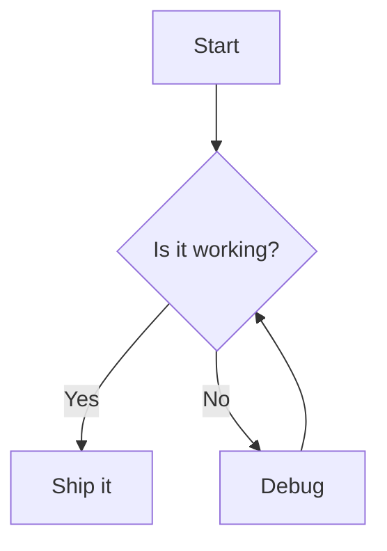
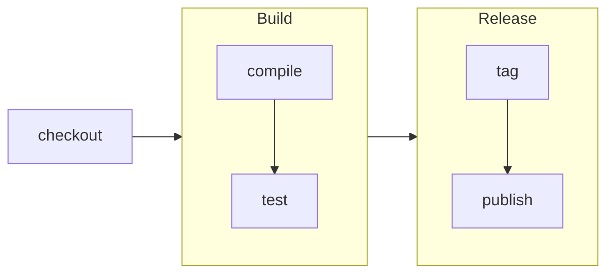
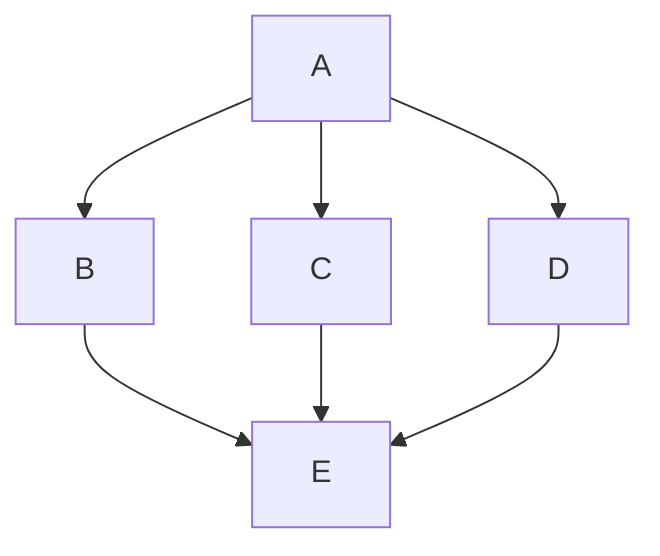

# Layered Layout (v<MERMAID_RELEASE_VERSION>+)

```warning
The layered layout is in beta. It is opt-in: diagrams use it only when they ask for `layout: layered`. Its output may still change between releases, and it is not yet a replacement for the default layout.
```

The **layered** layout places nodes in ranks along the diagram direction and routes the edges between those ranks. It is built into Mermaid, so it needs no extra package, and it is part of the tiny build as well.

It works for every diagram that Mermaid lays out as a graph:

- Flowchart (the main target)
- Class
- State
- Entity relationship
- Requirement
- Mindmap

Kanban places its own items and is not affected by the `layout` setting.

## How to use

Set `layout: layered` in the diagram's frontmatter config, or site-wide with `mermaid.initialize({ layout: 'layered' })`:



Subgraphs, edges to subgraphs and a subgraph's own `direction` are supported:



Spacing comes from the diagram's existing `nodeSpacing` and `rankSpacing` settings, the same values the other layouts use.

If the layered layout fails on a diagram, Mermaid logs a warning and lays that diagram out with dagre instead, so the diagram still renders. The rendered `<svg>` then has a `data-layout-fallback="dagre"` attribute, so you can tell which layout drew it.

## Edge routing

`layered.edgeRouting` sets how edges are drawn between nodes:

| Value               | Description                                                                       |
| ------------------- | --------------------------------------------------------------------------------- |
| `rounded` (default) | Edges run on tracks with circular corners of radius 5, reduced on short segments. |
| `curved`            | Each edge runs as smooth curves between ranks.                                    |
| `stepped`           | Edges run on tracks between ranks; each turn is softened over at most 12 px.      |
| `straight`          | Each edge runs as straight lines from point to point.                             |



With `rounded`, edges and self-loops have small circular bends, with the radius reduced where a segment is too short. `stepped` uses the same tracks, but softens each turn with a wider curve of up to 12 px. Set `layered.edgeRouting: curved` for the previous smooth curves. With `curved`, an edge keeps its own curve, so `linkStyle 0 interpolate linear` still gives a straight line. With `rounded`, `stepped` or `straight`, the routing mode applies to every edge and replaces the edge's own `interpolate` / `curve` setting.

## Parity with dagre

The table below compares the layered layout with dagre for the features that most often differ between layouts. **Works** means the result matches dagre; **Gap** means it is visibly different or worse; **n/a** means the diagram does not have the feature.

| Feature                                 | Flowchart                                                           | Class                                                                    | State                                                                      | ER                                                                                                   | Requirement                                                                                        | Mindmap |
| --------------------------------------- | ------------------------------------------------------------------- | ------------------------------------------------------------------------ | -------------------------------------------------------------------------- | ---------------------------------------------------------------------------------------------------- | -------------------------------------------------------------------------------------------------- | ------- |
| Edge markers                            | Works                                                               | Works                                                                    | Works                                                                      | Gap: markers of ends that share a side can overlap; with `edgeRouting: curved`, crow's feet can lean | Gap: `contains` start marker can crowd nearby arrowheads, and is tilted with `edgeRouting: curved` | n/a     |
| Terminal labels (cardinality, end text) | n/a                                                                 | Gap: no room is kept for them, so they can sit under or against the node | n/a                                                                        | n/a                                                                                                  | n/a                                                                                                | n/a     |
| Cluster titles                          | Works; edges entering a subgraph from above can cross its title     | Works (namespaces); same title crossing as flowchart                     | Works (composite states); same title crossing as flowchart                 | n/a                                                                                                  | n/a                                                                                                | n/a     |
| Notes                                   | n/a                                                                 | Works                                                                    | Gap: `note left of` / `note right of` are not placed on the requested side | n/a                                                                                                  | n/a                                                                                                | n/a     |
| `linkStyle`                             | Works                                                               | n/a                                                                      | n/a                                                                        | n/a                                                                                                  | n/a                                                                                                | n/a     |
| Interpolation (`curve`, `interpolate`)  | Works with `curved`; `rounded`, `stepped` and `straight` replace it | Same as flowchart                                                        | Same as flowchart                                                          | Same as flowchart                                                                                    | Same as flowchart                                                                                  | n/a     |
| Click handlers and links                | Works                                                               | Works                                                                    | n/a                                                                        | n/a                                                                                                  | n/a                                                                                                | n/a     |

Other known differences:

- **Cycles** are broken differently than in dagre, so in a diagram with cycles some edges point the other way (for example a class relation drawn upwards, or a state choice ranked first). The result is valid but looks different from dagre.
- **Line hops** are not drawn. Where two edges cross, the lines cross plainly, as in dagre; only the `elk` and `swimlane` layouts have a `lineHops` setting.
- **Markers** sit square to the node with `rounded`, `stepped` and `straight`. The tilt named in the table happens only with `edgeRouting: curved`.
- **An edge between a subgraph and a node inside it** is drawn along the flow, between the subgraph's border and the node, and the subgraph grows to keep the edge's label clear of the node.
- **A subgraph nested inside itself** (`subgraph a` … `subgraph b` … `subgraph a`) is refused, as in dagre.
- **Self-loops** on ER entities are short, so both end markers sit close together.
- **Mindmaps** are drawn as a top-down tree, unlike the radial default (cose-bilkent) mindmap layout.

## Default-readiness checklist

The layered layout is planned to become the default after thorough testing. Before that happens, all of these must hold:

1. **Parity matrix:** the per-diagram matrix above, covering markers, terminal labels, cluster titles, notes, `linkStyle`, interpolation and click handlers, shows no gaps that block the switch.
2. **Visual review:** the full e2e `.mmd` corpus has been reviewed under `layout: layered`.
3. **Performance:** layout time is no worse than dagre on 7, 50 and 500-node flowcharts. The benchmark runs with `pnpm --filter mermaid bench:layered` in the Mermaid repository.
4. **Separate change:** switching the default is its own approved change in a minor release, and `layout: dagre` stays available.

Until then, `layout: layered` stays opt-in.
