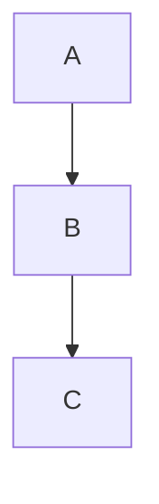
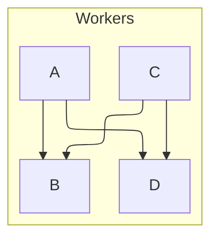

# Layouts

This page lists the available layout algorithms supported in Mermaid diagrams.

## ELK is bundled and default from v12.0.0

Before v12.0.0, ELK shipped as a separate `@mermaid-js/layout-elk` package that
each site had to install and register. It is now part of `mermaid` itself and
registered automatically, so `layout: elk` works with no setup — and it is the
**default**, replacing Dagre.

`elk` is the new default layout for these diagrams:

- Flowchart
- State
- Class
- Entity relationship
- Requirement
- Use case
- Agentflow

To go back to the previous layout, use `layout: dagre`.

The main `mermaid` package always includes ELK. If you want Mermaid without it,
use the [tiny build](./usage.md#elk-and-the-tiny-build), which omits ELK along
with some diagram types. `@mermaid-js/layout-elk` is still published so the tiny
build can opt back in.

## Supported Layouts

- **elk** (default): [ELK (Eclipse Layout Kernel)](https://www.eclipse.org/elk/). Bundled with Mermaid; no setup required. Specific ELK algorithms can be selected as `elk.stress`, `elk.force`, `elk.mrtree`, `elk.sporeOverlap`, `elk.box`, and `elk.rectpacking`.
- **dagre**: Dagre layout for layered graphs
- **cose-bilkent**: Cose Bilkent layout for force-directed graphs
- **tidy-tree**: Tidy tree layout for hierarchical diagrams, from the [`@mermaid-js/layout-tidy-tree`](https://www.npmjs.com/package/@mermaid-js/layout-tidy-tree) package [Tidy Tree Configuration](/config/tidy-tree)

Mindmaps are the one diagram type not laid out with ELK by default; they use
cose-bilkent unless you ask for something else.

The **tiny** build omits ELK to stay small, and falls back to Dagre for
diagrams that request it. See
[ELK and the tiny build](./usage.md#elk-and-the-tiny-build) for how to register
`@mermaid-js/layout-elk` there if you want ELK anyway.

## How to Use

Since `elk` is the default, a diagram needs no configuration to use it. To pick
a different layout, set it in your diagram's YAML config or initialization
options. For example:

## Automatic ELK readability (v<MERMAID_RELEASE_VERSION>+)

Selecting `layout: elk` automatically compares a bounded, deterministic set of
ELK Layered layouts, including the ordinary layout. Candidates are scored after
accounting for measured subgraph titles: node safety first, then crossings,
hop feasibility and route complexity. No extra optimization settings are needed.
Smaller graphs try four candidates, medium graphs two, and large graphs retain a
single pass to bound rendering cost. Other ELK algorithms keep their own layout
semantics; the common painted-edge/title protection still applies.

After painting, actual SVG/HTML title bounds are checked. A title is shifted
horizontally only when a safe position exists inside its frame; otherwise local
orthogonal edge detours are attempted without moving endpoints or crossing
adjacent nodes. This does not conceal lines behind opaque title backgrounds.

Non-Layered engines retain their node placements. Their straight or stale routes
are checked against painted node text; supported routes can be re-clipped and
locally detoured before title/frame/hop processing. Repaired midpoint labels
follow the new route. This does not guarantee that every edge label or terminal
label is collision-free. Unplaced null node coordinates are omitted before
calling elkjs (including mindmap inputs).

Frame clearance is also checked: sustained parallel runs on a rectangular node
or subgraph border are moved to a separate lane. A perpendicular boundary
crossing is a valid entry/exit, not a border-overlap violation. Titles use an
invisible geometric exclusion region; no extra title box, fill, stroke or opaque
background is inserted. Fallback detours are localized so distant conservative
shape bounds do not block an otherwise safe repair.

Arcs are preferred at remaining crossings. When neither edge can accommodate an
arc, or a crossing lies on a rounded corner, a transparent edge-only gap is used
as a fallback. Dash styles and marker clearance are preserved. Existing
`elk.lineHops: false` still disables crossing decoration; title protection remains
active. Existing `arc` and `gap` choices remain supported.

Crossing minimization is heuristic, **not a guarantee of the global minimum**.
Collinear shared paths are not point crossings. Arbitrary smoothing curves,
hand-drawn paths, impossible title clearances and author-owned SVG masks may
require diagram-specific routing; the default rounded ELK routes are the primary
supported geometry. Changes in fonts or ELK versions can change layout choices.

A bounded whole-route bend-reduction pass runs after a complete feasible frame
routing pass, not against stale peer routes. It compares shortcuts/shared lanes
while preserving signed port headings and existing edge-label attachment. It
rejects new node/title/frame violations, additional rounded-path point crossings,
self crossings and immediate stroke retracing. Bend count is compared before
length; an already safe route is not lengthened. Existing feasible routes remain
the fallback. This is not a certificate of minimum bends over all possible layouts.
